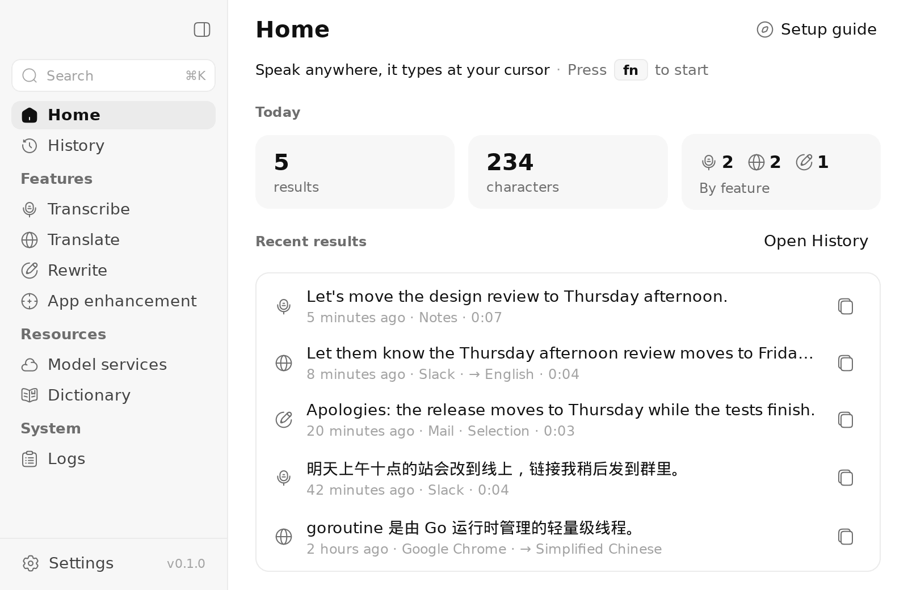
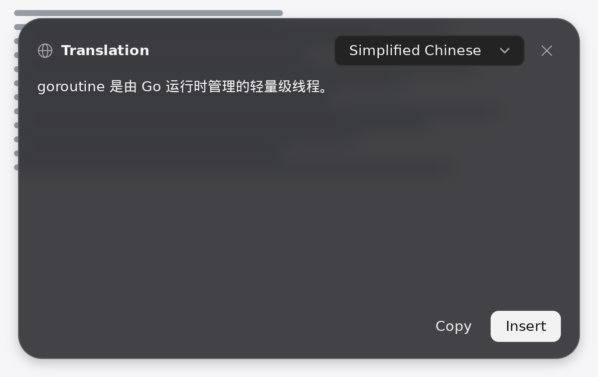
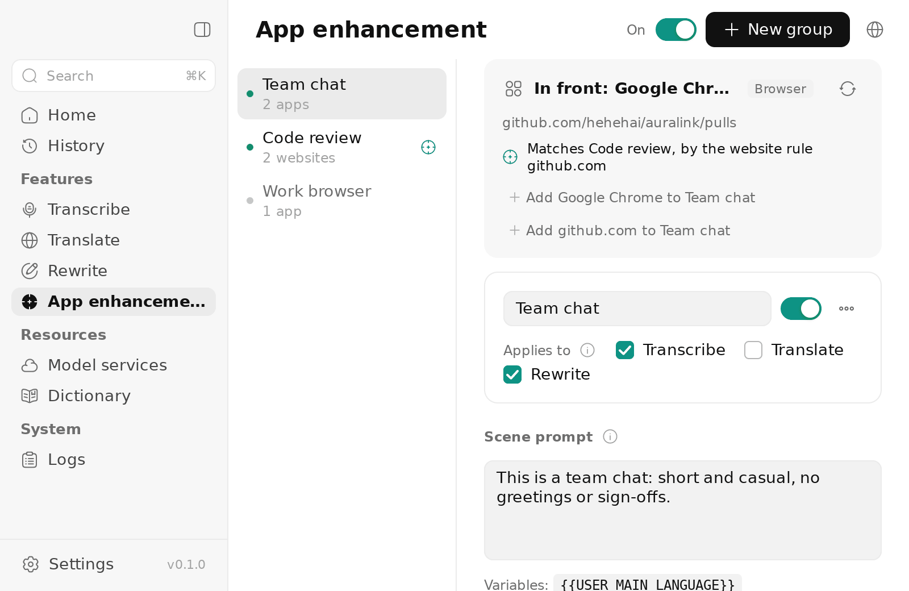

# Auralink

**Speak anywhere on your Mac, get text where your cursor is.** Auralink is a voice input app for macOS that uses remote models only: you choose the speech and language services and bring their keys.



- **Transcribe**: press a shortcut (fn by default), speak, and the cleaned-up text is typed into the app in front: fillers and false starts go, punctuation and numbers are fixed, your own rules are applied.
- **Translate**: the text you select, or what you say, into the language you choose (fn ⇧). Results can go to an answer card instead, to read, copy or insert.
- **Rewrite**: select text and say how to change it ("shorter", "more formal"), or say what to write with nothing selected (fn ⌃). Follow-ups refine the answer.
- **App enhancement**: rules by app or by website (a casual tone in chats, a formal one in mail, Return after inserting in a messenger), layered on top of the clean-up. The overlay shows which group applies.
- **Dictionary**: the names and jargon you use, sent as hints to speech recognition and as a glossary to the language model.

[中文说明](README.zh-CN.md)

| The overlay while you speak, and the answer card | App enhancement |
|---|---|
|   |  |

## Install

Auralink needs **macOS 15 or later on Apple silicon**. Intel Macs are not supported yet (the helper is built for arm64 only).

1. Download `Auralink <version> arm64.dmg` from [Releases](https://github.com/hehehai/Auralink/releases) and drag Auralink to Applications. Releases are signed with a Developer ID and notarised by Apple.
2. Open it from Applications (not from the disk image: an app run from there cannot update itself).
3. The setup guide opens: allow the **Microphone** and **Accessibility** (to type results, read the selection and use fn as a shortcut), set up a speech service and a language model, and try each feature. Settings → General opens it again.

**Updates**: Auralink checks GitHub Releases once a day and shows a new version's notes in a window of its own; it installs only when you say so (a small download of what changed), then offers to restart. Settings → About checks at once and turns the daily check, or installing without asking, on and off. Updates keep the Microphone and Accessibility grants. To update itself Auralink must be able to write where it is: in `/Applications` that takes an administrator account; otherwise put it in `~/Applications`.

**Coming from a build you made yourself** (ad hoc signed): macOS does not carry its grants over to the released app. Once, before opening the release: `tccutil reset Microphone dev.hehehai.auralink && tccutil reset Accessibility dev.hehehai.auralink`, then allow both again (an Accessibility entry that shows on but does nothing: remove it with − and add Auralink again).

## Services

Bring a key for at least one speech service; a language model is needed for the clean-up, Translate and Rewrite (without one, Transcribe types the text as recognised).

| Speech recognition | Language models |
|---|---|
| Doubao (Volcengine big-model streaming ASR) | DeepSeek · Qwen (Alibaba Cloud Model Studio, China and international) · Volcengine Ark (Doubao) · Moonshot (Kimi) · Zhipu GLM · MiniMax · StepFun · Xiaomi MiMo · SiliconFlow |
| Alibaba Cloud Model Studio (Fun-ASR, Paraformer, Qwen3-ASR realtime) | OpenAI · Anthropic · Gemini · OpenRouter · Groq · xAI · Mistral · Together · Fireworks · Cerebras · NVIDIA |
| StepFun (step-asr) | |
| Any OpenAI-compatible transcription API (OpenAI, Groq, SiliconFlow…) | Any OpenAI-compatible endpoint |

Keys live in the macOS Keychain. Model services shows which service each feature uses, and tests each connection.

## Privacy

- Your audio and text go only to the services you set up. Auralink has no server of its own, no account and no analytics; each service's own terms apply to what it receives.
- API keys are kept in this Mac's Keychain, never in the settings, history or logs.
- History (and, if you turn it on, the recordings) stays on this Mac, in `~/Library/Application Support/Auralink`; Settings → Privacy turns it off. Logs hold lengths and timings, not your text, unless you allow it.
- Browser addresses are read through Accessibility only to pick an app enhancement group; they are never sent to a model.

## Build

Needs Go 1.27.1 (`GOTOOLCHAIN=auto` fetches it) and, to package, a Mac with macOS 15 or later on Apple silicon and Xcode (the Swift helper, [helper/](helper/README.md)).

```sh
scripts/build-helper.sh              # the Swift helper, into resources/darwin-arm64/helper/
go tool mygo dev                     # run with hot reload
go tool mygo build                   # build/darwin-arm64/Auralink.app and "Auralink 0.1.0 arm64.dmg"
```

From Linux, `scripts/mac.sh <command>` mirrors the project to a Mac (`MAC_HOST`, default `mac-air`; `MAC_DIR`, default `code/Auralink`) and runs the command there: `scripts/mac.sh 'scripts/build-helper.sh && go tool mygo build'`.

Releases are built, signed, notarised and published by GitHub Actions on a tag: [docs/release.md](docs/release.md).

The design is in [docs/architecture.md](docs/architecture.md) (a Go app on [MyGo](https://github.com/egoist/mygo), no cgo, and a small Swift helper for the microphone, the keyboard and Accessibility) and [docs/behavior.md](docs/behavior.md) (what Auralink does differently from Voxt, and why).

### Signing during development

macOS keeps the Microphone and Accessibility grants for a signature. An ad hoc signed build (the default) has a new one each time the app is rebuilt, so after a rebuild macOS forgets them: the microphone turns **denied without asking again**, and Accessibility still shows on in System Settings but does not work. The helper's grants are the app's (macOS checks the helper against Auralink.app, its responsible process), so the same happens to it. Ways around it:

- **Change only the helper:** keep one built app and run it with a helper outside the bundle. The helper inherits the app's grants wherever it lives, so rebuilding it costs nothing:
  ```sh
  scripts/build-helper.sh --out ~/auralink-dev
  open --env AURALINK_HELPER=$HOME/auralink-dev/auralink-helper build/darwin-arm64/Auralink.app
  ```
- **Start over:** `tccutil reset Microphone dev.hehehai.auralink` (likewise `Accessibility`), then open the app and grant again. If a stale Accessibility entry stays on but does nothing, remove it with − in System Settings and grant again.
- **Sign with a fixed identity:** an Apple Development certificate keeps the grants across rebuilds: `go tool mygo build -sign "Apple Development: …"` (or `macos.signingIdentity` in a local mygo.json; `AURALINK_SIGN_IDENTITY` for `scripts/build-helper.sh`). Over ssh, `codesign` fails with `errSecInternalComponent` until the key may be used without the GUI: once, in Terminal on the Mac, `security set-key-partition-list -S apple-tool:,apple: -s ~/Library/Keychains/login.keychain-db`.

### Tests

```sh
CGO_ENABLED=0 go test ./...          # everything; runs on Linux
go tool mygo vet .                   # go vet and MyGo's UI-lifetime checks
AURALINK_SNAPSHOTS=/tmp/shots go test -run TestSnapshots .   # every page as PNG, light/dark, en/zh-Hans
cd helper && swift test              # the Swift helper (on a Mac): its wire types against the same fixtures, the hotkey recognizer
```

The store's tests use MyGo's SQLite plugin, which downloads its library once (checked against its SHA-256) or uses `MYGO_SQLITE_LIBRARY`. More in [docs/architecture.md](docs/architecture.md) §6. CI runs the Go side on Linux and the Swift helper's tests on macOS; what needs permissions, a GUI and real services is checked by hand with [docs/manual-test.md](docs/manual-test.md) (in Chinese). Changes are listed in [CHANGELOG.md](CHANGELOG.md).

## Acknowledgements

- [Voxt](https://github.com/hehehai/voxt): Auralink rewrites what it does (with remote models only), feature by feature; [docs/behavior.md](docs/behavior.md) compares the two.
- [AudioSmith](https://github.com/hehehai/AudioSmith): the window, the UI kit, the settings, the store and the engine supervisor Auralink's helper grew from.
- [MyGo](https://github.com/egoist/mygo): native macOS UI from Go, without cgo.
- [Solar](https://www.figma.com/community/file/1166831539721848736) icons by 480 Design, under CC BY 4.0.

## Licence

Apache License 2.0 ([LICENSE](LICENSE)). Parts come from AudioSmith; icons are Solar by 480 Design under CC BY 4.0 ([NOTICE](NOTICE)).
