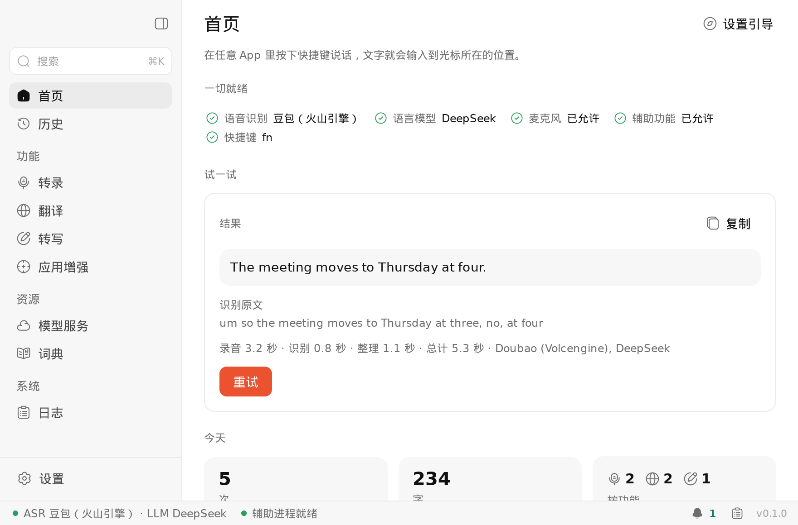
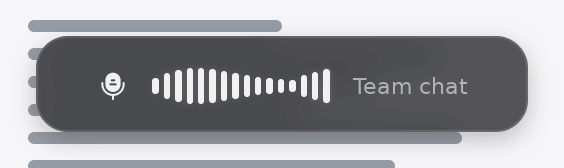
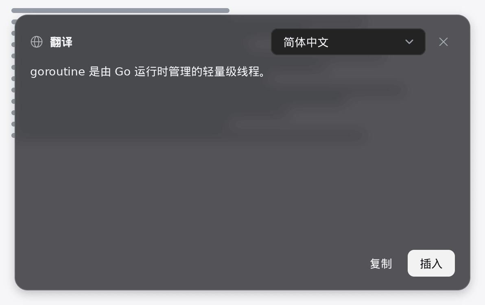
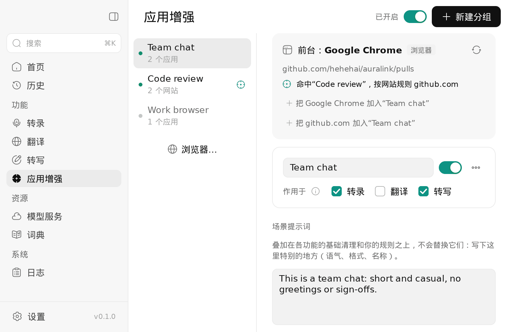

# Auralink

**在 Mac 上任何地方说话，文字直接出现在光标处。** Auralink 是一个只用远程模型的 macOS 语音输入 app：语音和语言服务由你来选，使用你自己的 API Key。



- **转录**：按下快捷键（默认 fn）说话，整理后的文字直接输入到当前 App：去掉口头语和说错重来的部分，修正标点和数字写法，并应用你自己的规则。
- **翻译**：把选中的文字或你说的话翻译成你选的语言（fn ⇧）。也可以让结果显示在答案卡片里，阅读、复制或插入。
- **转写**：选中文字后说出修改要求（“精简一点”“改正式”），或者不选文字，直接说出要写什么（fn ⌃）。可以继续追问，调整结果。
- **应用增强**：按 App 或网站设置规则（聊天时口语一些，写邮件时正式一些，在聊天软件里插入后自动按回车），叠加在基础清理之上。浮窗会显示命中了哪个分组。
- **词典**：你常用的人名和术语，作为提示发给语音识别、作为术语表发给语言模型。

[English](README.md)

| 说话时的浮窗和答案卡片 | 应用增强 |
|---|---|
|   |  |

## 安装

Auralink 0.1 需要 **macOS 15 及以上、Apple 芯片的 Mac**。

1. 从 [Releases](https://github.com/hehehai/Auralink/releases) 下载 `Auralink 0.1.0 arm64.dmg`，把 Auralink 拖进“应用程序”。
2. 0.1 版本是 **ad-hoc 签名**，没有经过公证，第一次打开时 macOS 会拒绝。可以在“应用程序”里右键 Auralink → 打开 → 打开；或者先打开一次，再到 系统设置 → 隐私与安全性 点 **仍要打开**。也可以在终端里执行：
   ```sh
   xattr -dr com.apple.quarantine /Applications/Auralink.app
   ```
3. 首次启动会打开设置引导：允许**麦克风**和**辅助功能**（用于输入结果、读取选中文字、把 fn 当作快捷键），配置一个语音识别服务和一个语言模型，并把每个功能试一遍。之后可以在 设置 → 通用 中重新打开。

**每次更新后**，macOS 会把 ad-hoc 签名的 app 当作一个新 app：请到 系统设置 → 隐私与安全性 → 辅助功能，用 − 删掉 Auralink 再重新添加（开关看着开着，但可能已经不生效）。如果录音不工作，执行 `tccutil reset Microphone dev.hehehai.auralink` 后重新允许。

## 支持的服务

至少需要一个语音识别服务的 Key；整理、翻译和转写需要语言模型（没有语言模型时，转录会直接输入识别出的原文）。

| 语音识别 | 语言模型 |
|---|---|
| 豆包（火山引擎大模型流式语音识别） | DeepSeek · 通义千问（阿里云百炼，国内和国际站）· 火山方舟（豆包）· 月之暗面（Kimi）· 智谱 GLM · MiniMax · 阶跃星辰 · 小米 MiMo · 硅基流动 |
| 阿里云百炼（Fun-ASR、Paraformer、Qwen3-ASR 实时） | OpenAI · Anthropic · Gemini · OpenRouter · Groq · xAI · Mistral · Together · Fireworks · Cerebras · NVIDIA |
| 阶跃星辰（step-asr） | |
| 任意 OpenAI 兼容的转写接口（OpenAI、Groq、硅基流动等） | 任意 OpenAI 兼容的接口 |

Key 保存在 macOS 钥匙串里。“模型服务”页显示每个功能使用哪个服务，并可以逐个测试连接。

## 隐私

- 音频和文字只发给你配置的服务。Auralink 没有自己的服务器，不需要账号，也不做统计；服务收到的内容适用该服务自己的条款。
- API Key 只保存在这台 Mac 的钥匙串里，不会出现在设置、历史或日志中。
- 历史（以及你选择保留的录音）只保存在本机 `~/Library/Application Support/Auralink`，可以在 设置 → 隐私 中关闭。日志里只记长度和耗时，除非你允许，否则不记录文字内容。
- 浏览器网址只通过辅助功能读取，用来匹配应用增强分组，不会发给模型。

## 构建

需要 Go 1.27.1（`GOTOOLCHAIN=auto` 会自动获取）；打包需要 macOS 15 及以上的 Apple 芯片 Mac 和 Xcode（编译 Swift 辅助进程，见 [helper/](helper/README.md)）。

```sh
scripts/build-helper.sh              # 编译辅助进程，放到 resources/darwin-arm64/helper/
go tool mygo dev                     # 热重载运行
go tool mygo build                   # 生成 build/darwin-arm64/Auralink.app 和 “Auralink 0.1.0 arm64.dmg”
```

在 Linux 上开发时，`scripts/mac.sh <命令>` 会把项目同步到 Mac（`MAC_HOST` 默认 `mac-air`，`MAC_DIR` 默认 `code/Auralink`）并在那边执行，例如 `scripts/mac.sh 'scripts/build-helper.sh && go tool mygo build'`。

设计见 [docs/architecture.md](docs/architecture.md)（基于 [MyGo](https://github.com/egoist/mygo) 的 Go app，不用 cgo；另有一个负责麦克风、键盘和辅助功能的 Swift 辅助进程）和 [docs/behavior.md](docs/behavior.md)（和 Voxt 行为上的差异及原因）。

### 开发时的签名

macOS 按签名记住麦克风和辅助功能授权。默认的 ad-hoc 签名每次重编 app 都会变，重编之后授权就失效了：麦克风变成**拒绝，而且不再弹窗**；辅助功能在系统设置里看着还开着，实际不生效。辅助进程的授权算在 app 名下（macOS 按负责进程 Auralink.app 判定），所以它也一样。几个办法：

- **只改辅助进程时**：保留一个编好的 app，让它用 bundle 外的辅助进程。辅助进程放在哪里都继承 app 的授权，重编它不影响授权：
  ```sh
  scripts/build-helper.sh --out ~/auralink-dev
  open --env AURALINK_HELPER=$HOME/auralink-dev/auralink-helper build/darwin-arm64/Auralink.app
  ```
- **清掉重来**：`tccutil reset Microphone dev.hehehai.auralink`（`Accessibility` 同理），再打开 app 重新授权。如果辅助功能条目开着却不生效，在系统设置里用 − 删掉它再重新授权。
- **用固定的签名身份**：用 Apple Development 证书签名，重编后授权仍然有效：`go tool mygo build -sign "Apple Development: …"`（或者在本地的 mygo.json 里设 `macos.signingIdentity`；`scripts/build-helper.sh` 用 `AURALINK_SIGN_IDENTITY`）。通过 ssh 签名时 `codesign` 会报 `errSecInternalComponent`，需要先在 Mac 的终端里执行一次 `security set-key-partition-list -S apple-tool:,apple: -s ~/Library/Keychains/login.keychain-db`。

### 测试

```sh
CGO_ENABLED=0 go test ./...          # 全部测试，Linux 上可跑
go tool mygo vet .                   # go vet 加 MyGo 的 UI 生命周期检查
AURALINK_SNAPSHOTS=/tmp/shots go test -run TestSnapshots .   # 每个页面的截图：浅色/深色 × 中/英
cd helper && swift test              # Swift 辅助进程（在 Mac 上）：协议类型对同一份 fixtures、热键识别器
```

CI 在 Linux 上跑 Go 这一侧，在 macOS 上跑 Swift 辅助进程的测试。需要权限、界面和真实服务的部分，按 [docs/manual-test.md](docs/manual-test.md) 手动验证。

更新记录见 [CHANGELOG.md](CHANGELOG.md)。

## 致谢

- [Voxt](https://github.com/hehehai/voxt)：Auralink 按功能逐项重写了它的行为（只用远程模型），两者的对照见 [docs/behavior.md](docs/behavior.md)。
- [AudioSmith](https://github.com/hehehai/AudioSmith)：窗口外壳、UI 组件、设置、存储，以及辅助进程监管程序的原型都来自它。
- [MyGo](https://github.com/egoist/mygo)：用 Go 写原生 macOS 界面，不用 cgo。
- 480 Design 的 [Solar](https://www.figma.com/community/file/1166831539721848736) 图标，以 CC BY 4.0 授权。

## 许可证

Apache License 2.0（[LICENSE](LICENSE)）。部分代码来自 AudioSmith；图标为 480 Design 的 Solar，以 CC BY 4.0 授权（[NOTICE](NOTICE)）。
